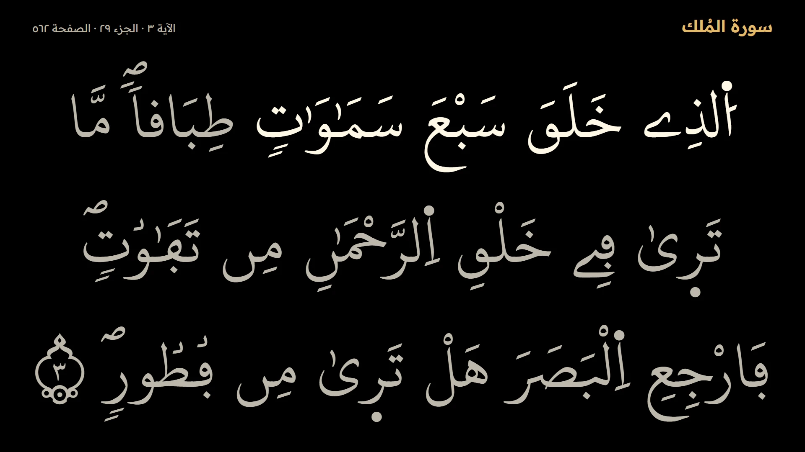
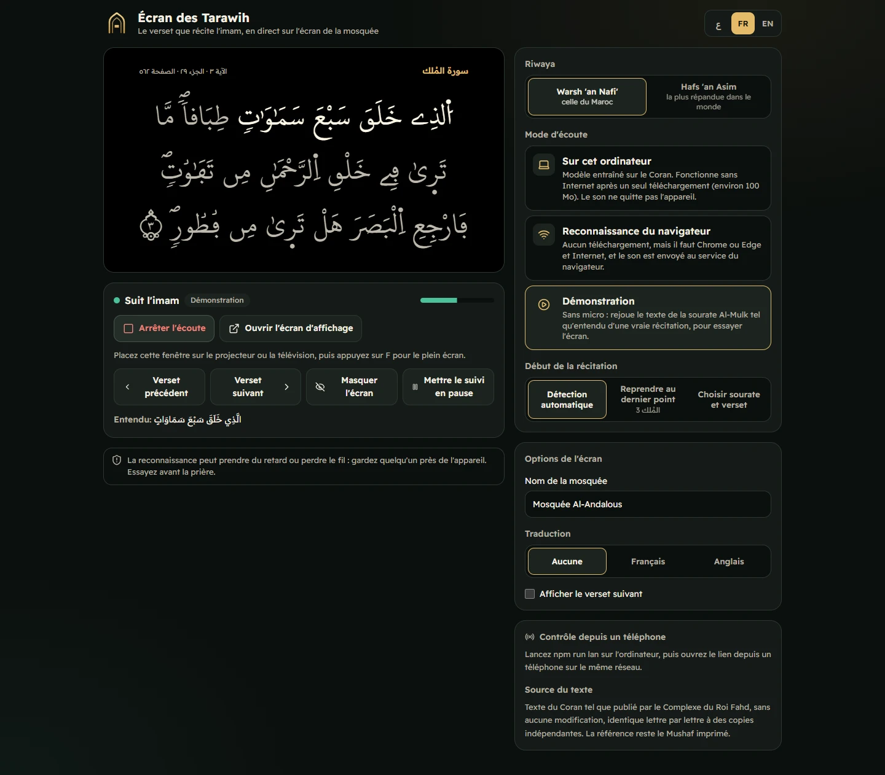
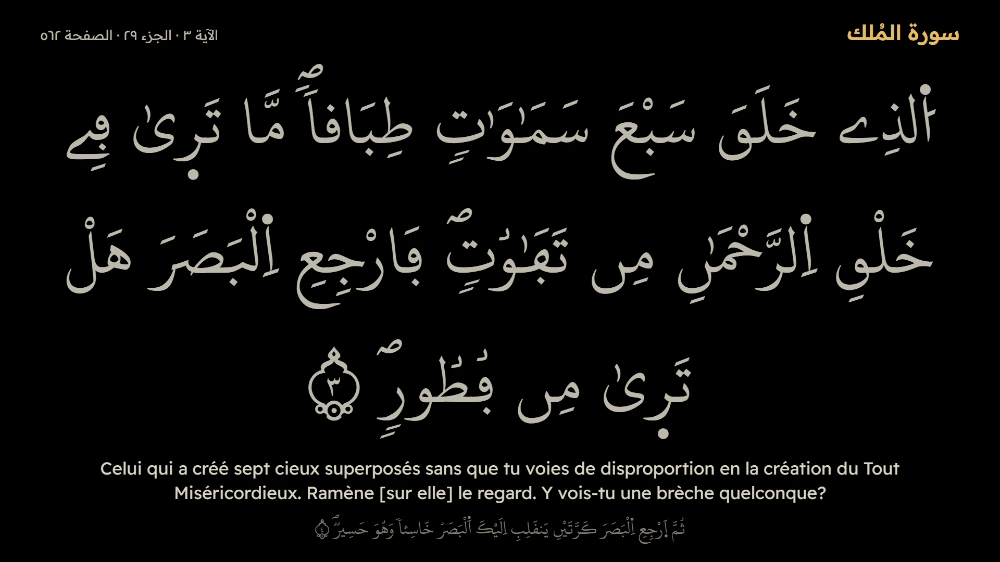

# شاشة التراويح · Tarawih Display

> Shows the verse the imam is reciting, live on the mosque TV or projector during Tarawih. Warsh and Hafs. No server, no account, and it works offline after one download.

**Author:** Oussama Elhadji (`@Bosaj`) <oussousselhadji@gmail.com>.

<p align="center">
  
</p>
<p align="center">
  
  
</p>

---

## Why

During Tarawih the congregation can't see which verse the imam is reciting. A screen that follows him helps people follow along, especially those learning, non-Arabic speakers and the hard of hearing. It is almost absent in Morocco, and most existing trackers assume Hafs, while Morocco reads **Warsh**.

## Set it up in the mosque

1. Plug a laptop into the mosque's sound system (line in or a microphone near a speaker) and into the projector or TV.
2. Open the app in Chrome or Edge, and choose the riwaya and **On this computer**. The first time, it downloads the model (about 100 MB).
3. Press **Open the display screen**, drag that window to the projector and press `F` for full screen.
4. Press **Start listening** before the prayer. Choose **Continue from the last place** to pick up from last night.
5. Keep someone near the laptop. Arrow keys or the on-screen buttons correct the verse, `B` hides the screen.

Try it first with **Demo**, which needs no microphone.

## What it does

| | |
|---|---|
| **Warsh and Hafs** | Each with its own text, verse division and font from the King Fahd Complex. Warsh is the default. |
| **Follows the imam** | Finds the place from what it hears, moves ayah by ayah, and shows which words were reached. |
| **Holds when unsure** | A wrong verse on a mosque screen is worse than a late one, so on noise or doubt the verse stays. |
| **Knows the prayer** | Al-Fatiha opens each rak'ah, then it returns to where the imam stopped. Takbir, "سمع الله لمن حمده" and "آمين" are ignored. Repeated refrains go to the next occurrence. |
| **Projector screen** | The verse as large as it fits, at any resolution. The longest ayah (2:282) turns pages as the imam reaches them. The display stays awake and hides the mouse pointer. |
| **Technician control** | Previous and next ayah, pause following, hide the screen, show any ayah. A manual correction always wins. |
| **Phone remote** | `npm run lan` serves the app on the mosque's network, with a remote at `/#/remote`. |
| **Translation** | Optional French (Hamidullah) or English (Saheeh International). They follow the Kufi count, and Warsh verses are mapped to the Kufi verses they overlap. |
| **Ramadan** | Remembers the running place each night for the next. |
| **Three languages** | Arabic (RTL), French, English on the technician's page. |

## Two ways to listen

| | On this computer | Browser speech recognition |
|---|---|---|
| Recogniser | Tarteel's Quran-trained Whisper, in the browser | Chrome or Edge's speech service |
| Internet | First download only | Always |
| Audio | Never leaves the device | Sent to the browser's service |
| Download | About 100 MB, once | None |
| Tested | On real recitation (below) | Not yet tested on real recitation |

## How accurate is it?

Measured with `npm run eval`: real recitations from [EveryAyah](https://everyayah.com) go through the Quran Whisper model into the tracker, with an 8-second window every 2 seconds, and the result is compared with the true position at each step.

| Recitation | Length | On the right verse | Within one verse | Wrong | Median lag |
|---|---|---|---|---|---|
| Warsh, Ibrahim Al-Dosary: Al-Mulk | 8:39 | 77.5% | 100% | 0% | 1 word |
| Warsh, Yassin Al-Jazaery: Al-Baqarah 1–25 | 8:09 | 80.9% | 100% | 0% | 1 word |
| Warsh, Ibrahim Al-Dosary: two rak'ahs, with Al-Fatiha before Al-Baqarah 100–110 and 111–118 | 12:36 | 85.7% | 100% | 0% | 0 words |

"On the right verse" is limited by the reference: the true position inside a verse is estimated from its length, and the display naturally changes a moment after a verse begins. A step of the 8-second window took about 1.6 s on a laptop CPU in Node.

**What this does not show:** these are clean studio recordings. A real imam in a mosque, with echo, a congregation and a cheap microphone, has not been tested yet. Please try it before relying on it, and report what happens.

## The text

The accuracy of the text is not negotiable, so:

- The Warsh (v10) and Hafs (v18) text and fonts are the [King Fahd Complex](https://qurancomplex.gov.sa)'s developer release, through [a mirror](https://github.com/thetruetruth/quran-data-kfgqpc) pinned to one commit. Surrounding spaces are the only thing removed.
- A test fails if the SHA-256 of the text changes (`src/lib/corpus-hashes.json`).
- `npm run corpus:verify` compares it with independent copies, on letters only:
  - **Warsh:** identical to the [quran-api](https://github.com/fawazahmed0/quran-api) Warsh edition in all 114 surahs (77,427 words).
  - **Hafs:** identical to [Tanzil](https://tanzil.net)'s Uthmani text in 6,234 of 6,236 verses. The other two (12:39, 12:41) are the same word يا صاحبي, written with a different seat for the alif.
- The matching forms used to compare what was heard are never shown.

The printed Mushaf remains the reference. If you find an error, please open an issue.

## Architecture

```
microphone → AudioWorklet → Web Worker (Quran Whisper, onnxruntime-web)
                                     ↓ words heard in the last 8 seconds
                       src/lib/tracker.ts: places them in the text
                                     ↓ ayah + word
technician's page (src/lib/engine.ts) → BroadcastChannel / LAN WebSocket → display windows, phone remote
```

```
src/lib/normalize.ts   spelling-tolerant word forms, used only for matching
src/lib/corpus.ts      text → word index, ayah boundaries, word pairs for searching
src/lib/tracker.ts     the matcher: follow, hold, Al-Fatiha, refrains, repeats
src/lib/recognizers.ts local model, browser speech, demo
src/lib/whisper.worker.ts  the model, on WebGPU when available, otherwise WebAssembly
src/lib/engine.ts      recogniser → tracker → screen state, manual corrections
src/lib/link.ts        keeps the windows and remotes in step
src/components/        the fitted, paged verse and the screen
src/pages/             Control (technician), Screen (projector), Remote (phone)
tools/                 build-corpus, verify-corpus, eval, lan-server
e2e/                   flow.mjs (pages), mic.mjs (real browser microphone)
```

## Getting started

Node 24.

```bash
npm install
npm run dev
```

```bash
npm test
```

```bash
npm run build
```

```bash
npm run lan
```

`npm run eval` needs `ffmpeg` and downloads recitations to a temp folder, never into the repo. `npm run corpus` rebuilds the data from its pinned sources.

## Roadmap

- [x] v0.1 — match a recorded recitation to ayat — [#1](https://github.com/Bosaj/quran-tarawih-display/issues/1)
- [x] v0.2 — live microphone and current-ayah resolution — [#2](https://github.com/Bosaj/quran-tarawih-display/issues/2)
- [x] v0.3 — full-screen display — [#9](https://github.com/Bosaj/quran-tarawih-display/issues/9)
- [x] v0.4 — Warsh and Hafs, translation, continue from last night, phone remote — [#4](https://github.com/Bosaj/quran-tarawih-display/issues/4), [#10](https://github.com/Bosaj/quran-tarawih-display/issues/10), [#11](https://github.com/Bosaj/quran-tarawih-display/issues/11)
- [ ] Test in a real mosque during prayer, and tune on what it shows
- [ ] Raspberry Pi kiosk image — [#3](https://github.com/Bosaj/quran-tarawih-display/issues/3)

---

## For LLM agents & contributors continuing this project

- Read `src/lib/tracker.ts` first: its top comment states the rules. Never trade "holds when unsure" for speed.
- Change the tracker with `npm run eval` open: transcripts are cached, so re-scoring takes seconds. Add a scenario for any failure you find.
- Never edit `public/data/*.json` by hand. Change `tools/build-corpus.mjs`, rerun it, and rerun `npm run corpus:verify`.
- Scoring is by word position, because EveryAyah numbers files by the Kufi count while Warsh verses end elsewhere.
- Follow Conventional Commits (see `CONTRIBUTING.md`). Never commit secrets or recitation audio.

## Credits

- Text and fonts: [King Fahd Glorious Qur'an Printing Complex](https://qurancomplex.gov.sa).
- Verification text: [Tanzil Project](https://tanzil.net), used verbatim. Keep the source visible and link to tanzil.net so that people can follow its text changes.
- Recognition model: [tarteel-ai/whisper-base-ar-quran](https://huggingface.co/tarteel-ai/whisper-base-ar-quran) (Apache-2.0), ONNX build by [aaqibhabib](https://huggingface.co/aaqibhabib/whisper-base-ar-quran-onnx), pinned to one revision.
- Translations: Muhammad Hamidullah (French) and Saheeh International (English), through [AlQuran Cloud](https://alquran.cloud).
- Test recitations: [EveryAyah](https://everyayah.com), not redistributed.

## 📄 License
**Proprietary Cultural & Non-Commercial Educational License** — All Rights Reserved © 2026 Oussama Elhadji (`@Bosaj`) <[oussousselhadji@gmail.com](mailto:oussousselhadji@gmail.com)>.

Free for personal learning and mosque worship. Commercial resale, monetization, and sublicensing are strictly prohibited. See [LICENSE](LICENSE) for full terms. The Qur'an text, fonts, translations and model above remain under their own terms.
